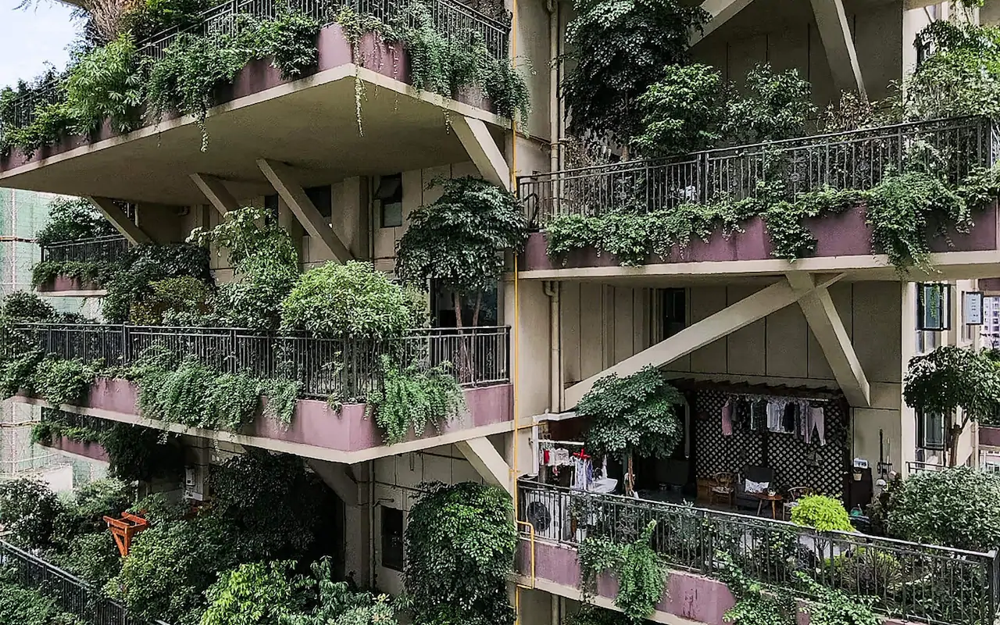
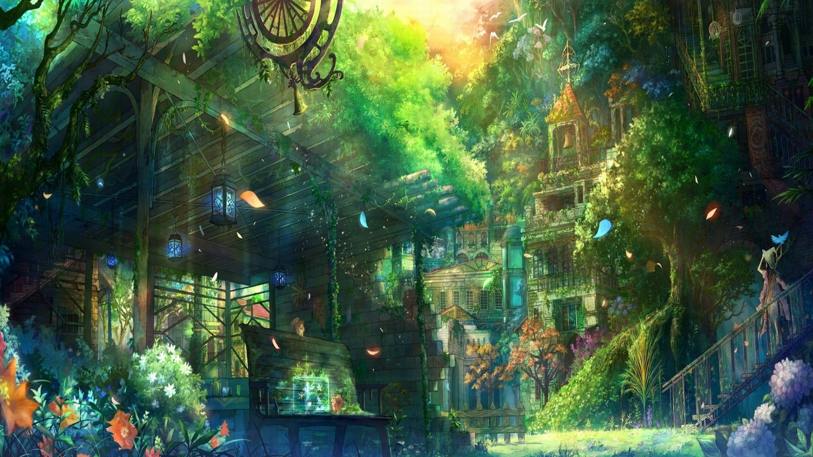
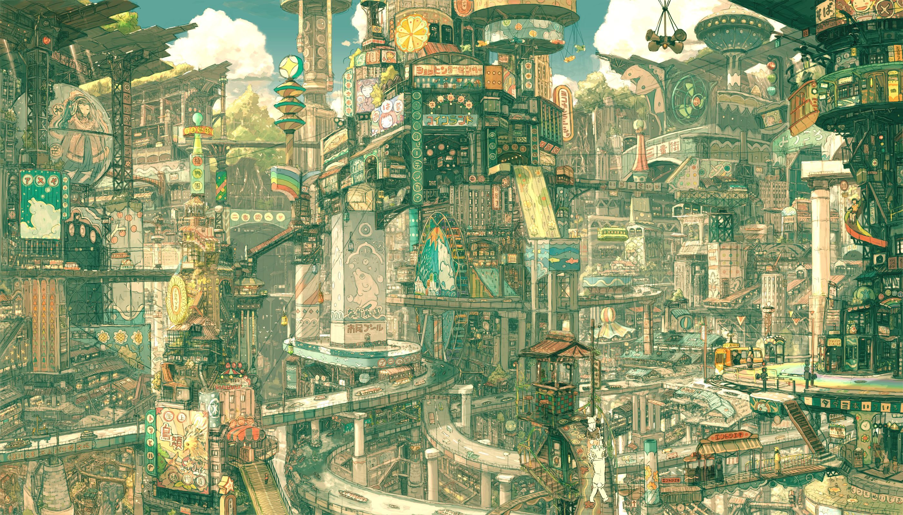
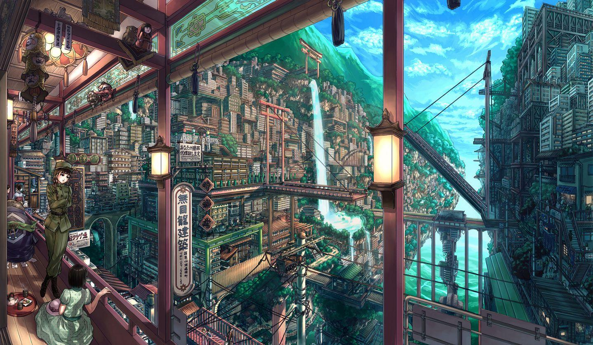
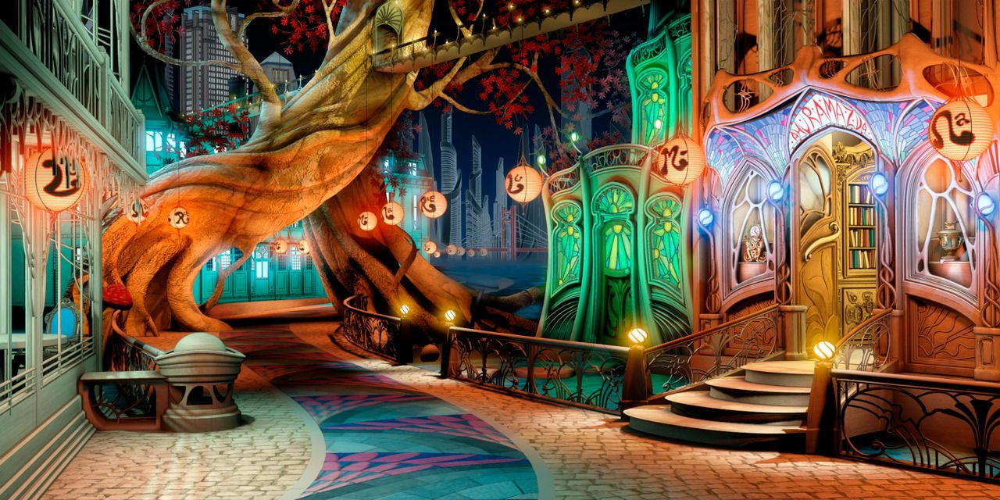
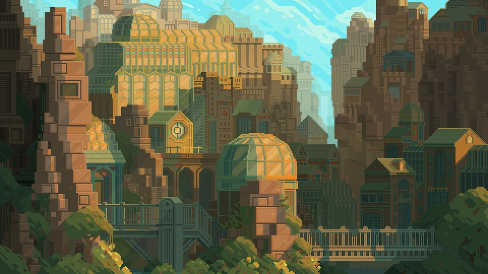

# Omarchy Solarpunk Theme

A dark, bioluminescent-evening theme for Omarchy: deep conifer-night
backgrounds, luminous leaf and sea-glass syntax, and a solar-gold accent.
Nature first, technology as its scaffold.

The bright sibling is [omarchy-solarpunk-light-theme](https://github.com/infurno/omarchy-solarpunk-light-theme).

## Install

```
omarchy theme install https://github.com/infurno/omarchy-solarpunk-theme
```

or paste the URL into *Install > Style > Theme* from the Omarchy menu
(`Super + Space`).

## Palette

- Background: `#0f1b15`
- Foreground: `#d8e6d9`
- Accent (solar gold): `#f2c14e`
- Leaf green: `#7ecb89`
- Sea-glass cyan: `#57d0bd`
- Sky blue: `#6fb1e8`
- Dusk violet: `#c99be8`
- Brick red: `#ef6a5b`
- Muted: `#6e8a79`

Window borders use a leaf-to-gold gradient (`hyprland_active_border`),
propagated to bar, notifications, launcher, and lock surfaces through the
Omarchy shell theme. Every app surface (terminals, btop, helix, neovim,
vscode, shell bar, ...) is generated from `colors.toml` by Omarchy itself.

## Wallpapers

| | | |
| --- | --- | --- |
|  |  |  |
|  |  |  |

Cycle with `omarchy theme bg next`.

## Attribution

Theme structure, palette, and Omarchy theme files are original, MIT-licensed.

Background artwork is community fan art sourced from the
[Solarpunk wallpapers](https://wallpapercave.com/solarpunk-wallpapers)
collection on wallpapercave.com (image ids: wp8457268, wp8457152,
wp8457075, wp5088635, wp8457145, wp8457149) — fine for personal use, of
varying licenses. Drop the `backgrounds/` directory before redistributing
if you need fully clean licensing.
